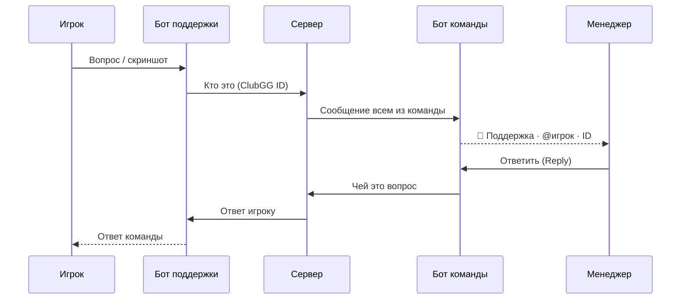

| Бот | Для кого | Что делает |
|---|---|---|
| **@zerakebot** | игроки | Открывает мини-приложение; присылает уведомления о ваших операциях; кнопка «Поддержка» |
| **Бот поддержки** | игроки | Принимает вопросы (текст, фото, файлы) и присылает ответы команды |
| **Бот команды** | только команда | Уведомления о новых заявках, ошибках агента, сообщения поддержки; кнопка «Открыть админку» |

## Как ходит сообщение в поддержку

Бот команды отвечает только людям из списка команды. Боты проверяют, что запросы пришли именно от Telegram.
