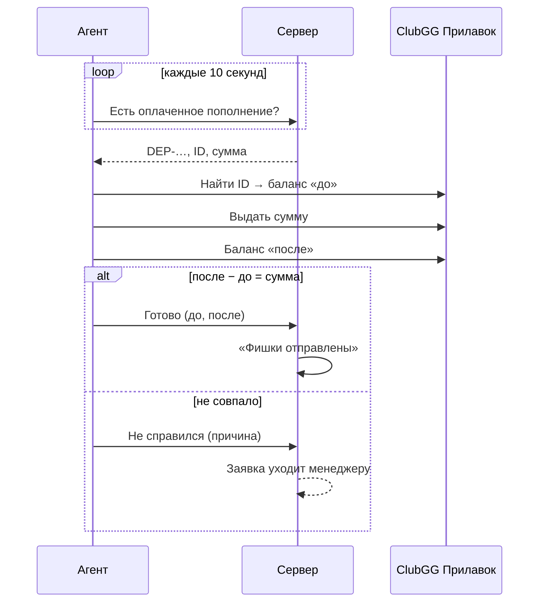

Фишки в ClubGG выдаются через **Прилавок клуба** («Выдать» / «Вернуть»). Это делает либо **агент**, либо **менеджер**.

## Агент

Агент — программа клуба на отдельном компьютере, которая выполняет те же действия, что менеджер на Прилавке.

Правила агента:

- **Только выдача фишек.** Снятия фишек агент не делает никогда — их обрабатывают люди.
- **Одна попытка.** Если агент не справился, заявка уходит менеджеру и к агенту больше не возвращается.
- **Проверка по балансу.** Агент подтверждает выдачу, только если баланс игрока вырос ровно на сумму.
- **Журнал на компьютере агента** не даёт выдать одну заявку дважды после перезапуска.

## Менеджер

Если агент выключен или не справился, заявку берёт менеджер в [админке](/team/queue/): «Беру» → выдаёт фишки в ClubGG → «Фишки выданы».
