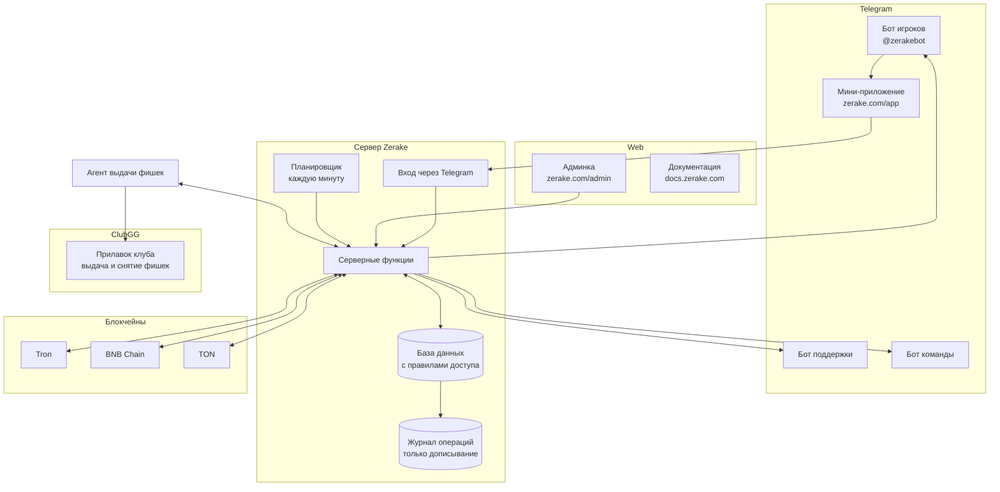

## Компоненты

| Компонент | Задача |
|---|---|
| **Мини-приложение** | Интерфейс игрока: пополнение, снятие, история, настройки. Статический сайт, вся логика — на сервере. |
| **Админка** | Интерфейс команды: очередь, все операции, журнал, поддержка, состояние кошельков. |
| **Серверные функции** | Создание заявок, проверки, привязка кошельков, выплаты, сканирование блокчейнов. |
| **База данных** | Профили, кошельки, заявки, пополнения, снятия. Игрок видит только свои строки. |
| **Планировщик** | Раз в минуту запускает поиск новых платежей во всех сетях параллельно. |
| **Журнал операций** | Каждое изменение пополнения или снятия; изменить или удалить записи нельзя. |
| **Агент** | Выдаёт фишки в ClubGG по оплаченным пополнениям. |
| **Боты** | Игроки, поддержка и команда — три отдельных бота. |

## Принципы

1. **Сервер решает, приложение показывает.** Любая проверка (PIN, кошелёк, сумма, баланс клуба) делается на сервере.
2. **Одна операция — одна запись — один исполнитель.** Заявку «берут» атомарно; два человека не обработают её одновременно.
3. **Ничего не выплачивается дважды.** Перед выплатой заявка блокируется; при сбое после отправки она остаётся на ручной проверке.
4. **Всё записывается.** Журнал хранит полную историю каждой операции.
