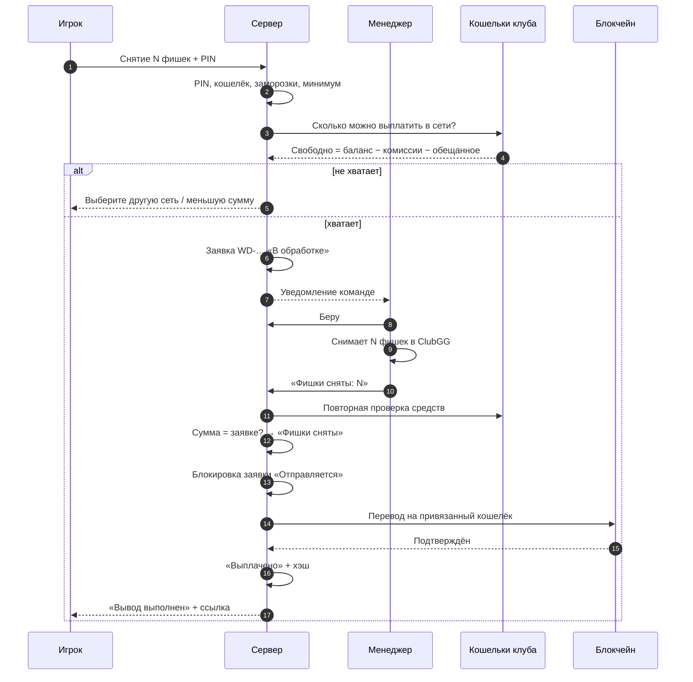
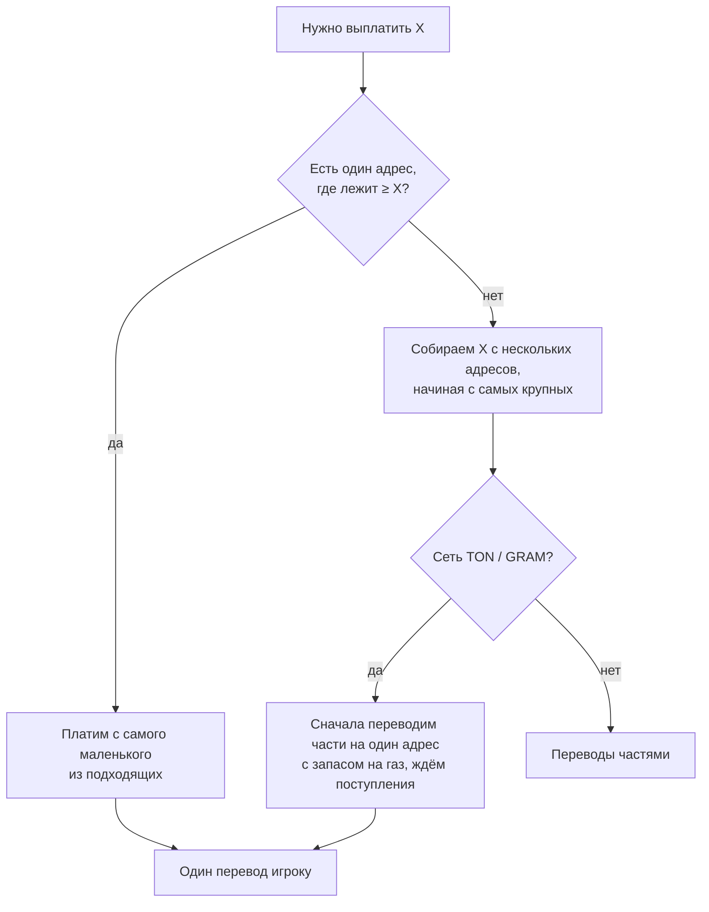

## Как выбирается, откуда платить

## Комиссии сети

| Сеть | Кто платит газ | Как |
|---|---|---|
| TRC20 | игрок (в комиссии снятия) | сервис GasFree списывает плату в USDT |
| BEP20 | клуб | отдельный адрес клуба докидывает BNB на газ |
| TON (USDT) | клуб | кошелёк клуба докидывает ~0.07 GRAM на газ |
| GRAM | клуб | газ из самой суммы на адресе |

## Сбои

- **Ничего не отправилось** → заявка возвращается команде («Фишки сняты»), причина видна в админке, можно повторить.
- **Отправилось, но подтверждение не пришло** → заявка остаётся «Отправляется» с пометкой «проверить вручную», команда получает предупреждение. Повторно автоматом такая заявка **не выплачивается**.
- **Сумма выше лимита автовыплаты** → выплачивает менеджер вручную.
