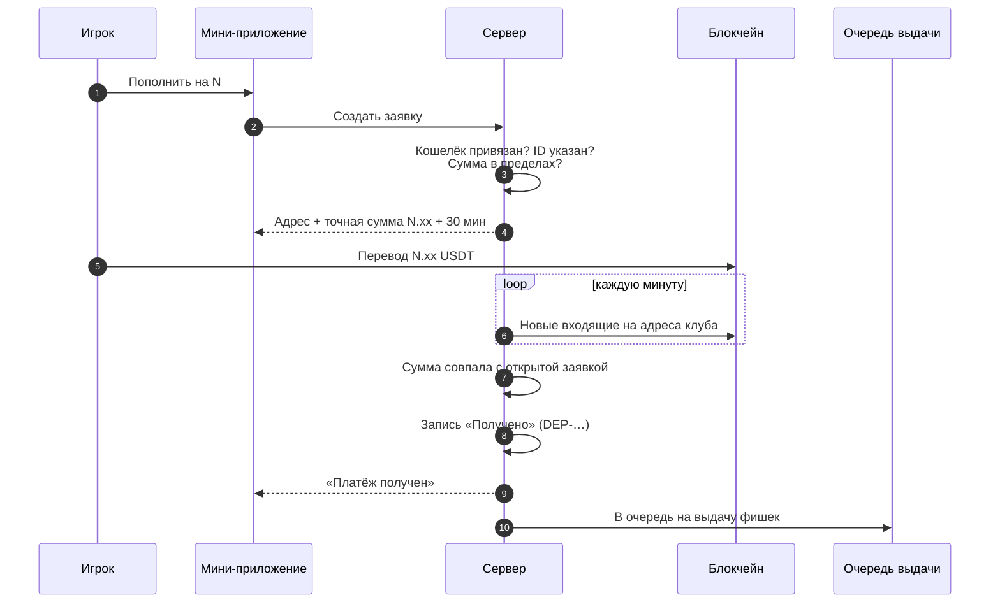
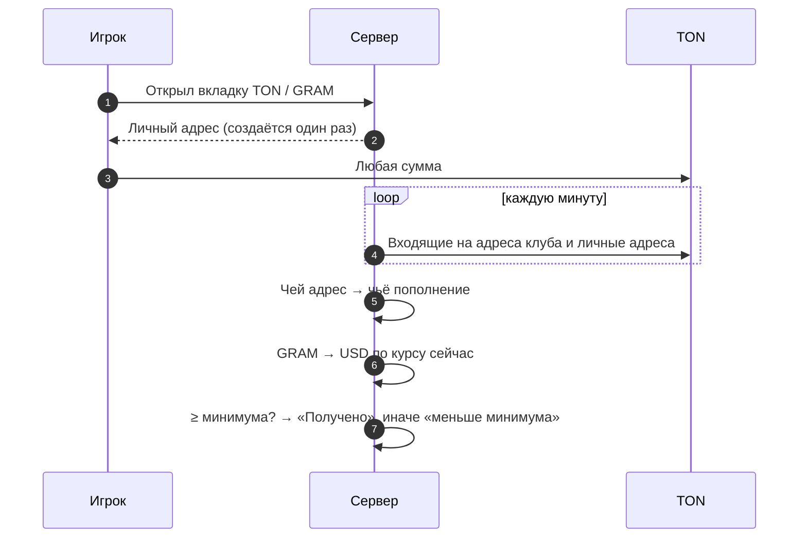

## TRC20 / BEP20 (заявка)

Платёж сопоставляется с заявкой по **адресу и точной сумме**. Платёж, который не совпал ни с одной заявкой, попадает в «неопознанные» и разбирается вручную.

## TON / GRAM (личный адрес)

Каждый личный адрес — отдельный кошелёк, ключ к которому выводится из ключа клуба по номеру. Платёж определяется по адресу, поэтому сумма и комментарий не нужны.

## Защита от повторов

Каждый перевод записывается по паре **сеть + хэш перевода** с уникальностью в базе: один и тот же перевод не может быть зачислен дважды, сколько бы раз ни запускалась проверка.
