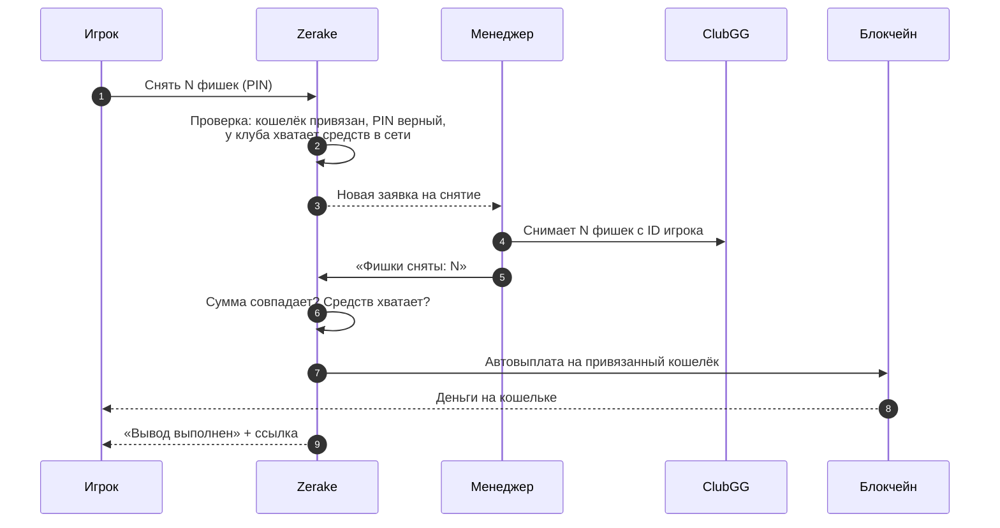

Снятие фишек: фишки снимаются с вашего ID в ClubGG, а деньги автоматически уходят на ваш **привязанный кошелёк**.

## Шаги

1. Вкладка **Продать** → выберите сеть.
2. Введите, сколько фишек снять. Приложение сразу покажет комиссию и сумму к получению.
3. Введите **PIN** → заявка создана.
4. Менеджер снимает фишки с вашего ID в ClubGG и подтверждает в системе **ровно ту же сумму**.
5. Выплата уходит **автоматически** — вы получаете уведомление со ссылкой на перевод в блокчейне.

## Важное

- Выплата идёт **только на привязанный кошелёк** этой сети.
- В TON и GRAM вы получаете **один перевод**, даже если клуб собирает сумму с нескольких адресов.
- Для GRAM сумма считается по курсу на момент заявки — в заявке видно, сколько GRAM придёт.
- Пока ждёт [смена кошелька](/account/recovery/) или прошло меньше 48 часов после восстановления аккаунта, снятие заморожено.
- Одновременно может быть открыта одна заявка на снятие.

Сколько стоит — [Комиссии](/cash-out/fees/). Почему заявку могут не принять — [Проверка платёжеспособности](/cash-out/solvency/).
