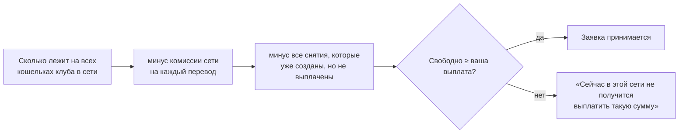

Перед каждым снятием Zerake проверяет, **хватает ли у клуба денег в этой сети**, чтобы выплатить его сразу.

## Как считается

Проверка выполняется **дважды**:

1. **Когда вы создаёте снятие.** Если не хватает — приложение предложит выбрать другую сеть или сумму поменьше.
2. **Перед тем как менеджер снимет фишки.** Если за это время ситуация изменилась, менеджер увидит предупреждение и **не будет снимать фишки**, пока клуб не пополнит кошельки. Так не может случиться, что фишки сняты, а выплатить нечем.

## Что делать, если снятие не принимается

- Выберите **другую сеть** — в ней может быть достаточно средств.
- Или снимите **меньшую сумму**.
- Или подождите: команда видит нехватку в админке и пополняет кошельки.

Сколько денег у клуба, приложение не показывает — только принимает или не принимает конкретную сумму.
