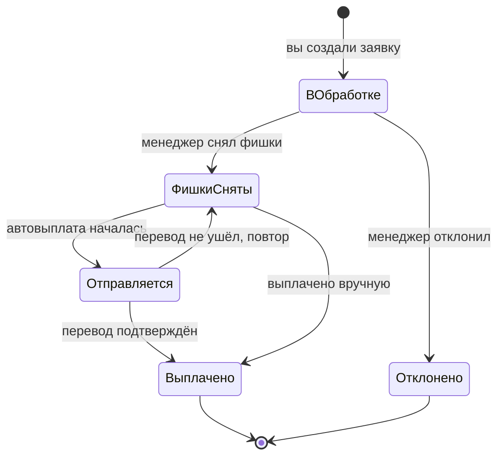

| Статус | Что значит |
|---|---|
| **В обработке** | Заявка создана, фишки ещё на вашем ID |
| **Фишки сняты, выплата в пути** | Фишки сняты, деньги отправляются |
| **Отправляем…** | Перевод отправлен в блокчейн, ждём подтверждения |
| **Выплачено** | Деньги на вашем кошельке, есть ссылка на перевод |
| **Отклонено** | Заявка закрыта, **фишки с ID не снимались** |

## Если выплата задерживается

Если автоматическая выплата не прошла (например, сеть перегружена), заявка возвращается команде со статусом «Фишки сняты», и менеджер повторяет выплату или выплачивает вручную. Деньги при этом не теряются: система не может выплатить одну заявку дважды.

Долго нет денег — напишите в поддержку с номером `WD-…`.
