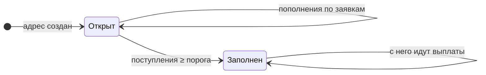

## Типы адресов

| Адрес | Сеть | Для чего | Сколько их |
|---|---|---|---|
| **Адрес пула** | TRC20 | Принимает пополнения по заявкам. Это GasFree-адрес: с него можно отправить USDT без TRX. | несколько, по очереди |
| **Адрес пула** | BEP20 | Принимает пополнения по заявкам | несколько, по очереди |
| **Адрес для комиссий** | BEP20 | Докидывает BNB на газ перед выплатой | один |
| **Кошелёк клуба** | TON | Платит газ за выплаты USDT в TON, тоже хранит средства | один |
| **Личный адрес игрока** | TON | Принимает USDT TON и GRAM только от одного игрока | по одному на игрока |

## Кто владеет ключами

1. Все адреса клуба выводятся из **ключей клуба** по порядковому номеру (иерархические кошельки).
2. Ключи хранятся **только в защищённых настройках сервера**. Их нет в коде, в базе, в приложении и у команды.
3. Сервер, который **выдаёт адреса** для пополнения, знает только **публичный ключ**: он может посчитать новый адрес, но не может отправить с него деньги.
4. Отправлять деньги умеет только **сервер выплат**, и только после всех проверок.

## Жизненный цикл адреса пула (TRC20, BEP20)

1. Когда нужна заявка, берётся **первый открытый адрес** пула.
2. Адрес принимает пополнения, пока сумма поступлений на нём не достигнет **порога заполнения** (по умолчанию 5 000 USDT).
3. После этого адрес помечается **«заполнен»** и новых заявок не получает.
4. Если открытых адресов нет, сервер **создаёт следующий** по номеру.
5. Деньги с заполненного адреса **никуда не переводятся**: с него платятся выплаты, когда понадобится.

Один адрес обслуживает **многих игроков одновременно**: платежи различаются по точной сумме заявки (см. [Пополнение по заявке](/money/deposit-request/)).

## Личный адрес (TON, GRAM)

1. Создаётся **один раз**, когда вы первый раз открываете вкладку TON или GRAM.
2. Закреплён **только за вами**: всё, что на него пришло, — ваше пополнение.
3. Сумма, комментарий и срок **не нужны**.
4. Деньги остаются на адресе, пока не понадобятся для выплаты.
