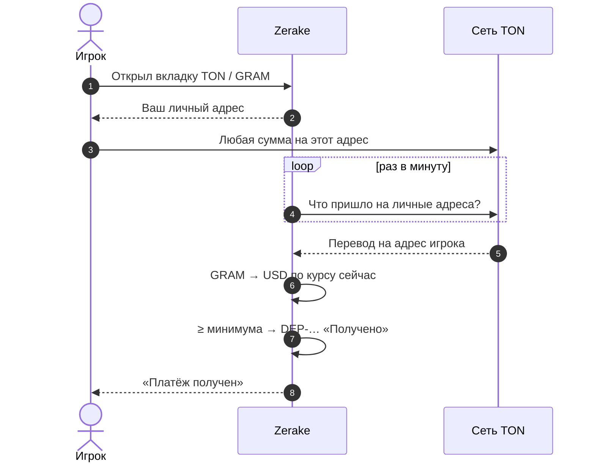

## Шаги игрока

1. Мини-приложение → **Купить** → **TON** (USDT) или **GRAM**.
2. Если кошелёк TON для выплат не привязан — привяжите (один раз, общий для TON и GRAM).
3. Скопируйте **ваш личный адрес** или отсканируйте QR.
4. Отправьте **любую сумму** от минимума: USDT в сети TON — на вкладке TON, GRAM — на вкладке GRAM.
5. Ждите «Платёж получен» → «Фишки зачислены».

## Что делает сервер

1. При первом открытии вкладки **создаёт ваш личный адрес** и закрепляет за вами.
2. **Раз в минуту** проверяет входящие на кошелёк клуба и на все личные адреса.
3. Видит перевод на **ваш** адрес → это ваше пополнение (сумма и комментарий не важны).
4. Для **GRAM** берёт курс GRAM/USDT **в этот момент** и считает фишки.
5. Сравнивает с минимумом: **1 USDT** для TON, **$1** для GRAM (с допуском 3% на курс).
6. Записывает `DEP-…` «Получено» (или «Меньше минимума») и уведомляет вас.
7. Ставит пополнение в очередь на выдачу фишек.

## Важно

- На адрес TON отправляйте **только USDT в сети TON или GRAM**. Другие монеты сервер не учитывает.
- Если на кошельке-отправителе совсем нет GRAM, перевод USDT в TON не уйдёт: газ платит отправитель.
- Мелкие служебные переводы (меньше 0.2 GRAM) пополнением не считаются.
