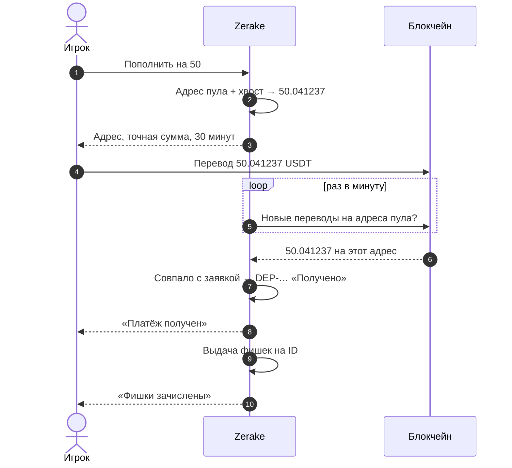

## Шаги игрока

1. Откройте мини-приложение → **Купить** → сеть **TRC20** или **BEP20**.
2. Если кошелёк для выплат в этой сети не привязан — привяжите (один раз).
3. Введите сумму в фишках, например **50**, → **Создать заявку**.
4. Скопируйте **точную сумму** (например, `50.041237 USDT`) и **адрес**.
5. Отправьте **ровно эту сумму** в выбранной сети. Сеть и сумму проверьте дважды.
6. Ждите: приложение само покажет «Платёж получен», затем «Фишки зачислены».

## Что делает сервер

1. Проверяет: ID в ClubGG указан, кошелёк привязан, сумма от **10** до **50 000** USDT.
2. Берёт открытый **адрес пула** этой сети (см. [Адреса клуба](/money/addresses/)).
3. Добавляет к сумме **уникальный «хвост»** от 0.000101 до 0.099999 USDT. Получается, например, `50.041237`.
4. Проверяет, что такой точной суммы на этом адресе ещё нет в открытых заявках. Если есть — выбирает другой хвост.
5. Сохраняет заявку на **30 минут** и показывает её вам.
6. **Раз в минуту** смотрит входящие переводы USDT на все адреса пула.
7. Находит перевод с **этой точной суммой на этот адрес** → это ваша заявка.
8. Записывает пополнение `DEP-…` со статусом «Получено» и присылает уведомление.
9. Ставит пополнение в очередь на выдачу фишек.

## Зачем «хвост»

- На один адрес платят **многие игроки**. Хвост делает сумму **уникальной**, и по ней видно, чья это заявка.
- Фишек вы получаете столько, сколько **заказали** (50), а не сколько отправили. Хвост — максимум 10 центов.

## Что если…

| Ситуация | Что будет |
|---|---|
| Прошло 30 минут, а вы уже заплатили | Платёж всё равно найдётся и зачислится |
| Отправили не ту сумму | Платёж станет «неопознанным», команда разберёт вручную — [см. проблемы](/money/problems/) |
| Биржа вычла комиссию из суммы | Дошло меньше → не совпало с заявкой. Отправляйте так, чтобы дошло ровно |
| Отправили в другой сети | Деньги, скорее всего, потеряны — [см. проблемы](/money/problems/) |
