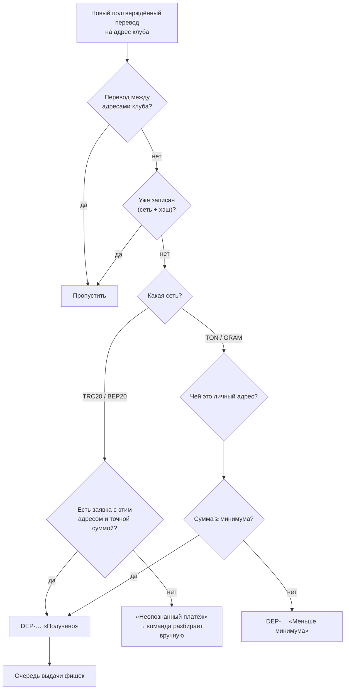

## По шагам

1. Планировщик запускает проверку **каждую минуту**.
2. Все четыре сети проверяются **одновременно**: медленная сеть не задерживает остальные.
3. Для каждой сети берутся **новые входящие переводы** на адреса клуба с прошлой проверки.
4. Чтобы ничего не пропустить, окно поиска **перекрывается** с прошлым на 15 минут.
5. Учитываются только **подтверждённые** переводы:
   - **Tron** — подтверждённые сетью;
   - **BNB Chain** — когда над блоком с переводом есть ещё **12 блоков**;
   - **TON** — финализированные транзакции.
6. Каждый перевод сопоставляется:
   - TRC20/BEP20 — с открытой заявкой по **адресу и точной сумме**;
   - TON/GRAM — с игроком по **личному адресу**.
7. Перевод записывается по паре **«сеть + хэш перевода»**. Эта пара уникальна в базе — один перевод **нельзя зачислить дважды**, даже если проверка увидит его снова.
8. Переводы **между адресами клуба** (объединение средств, газ) пополнениями не считаются.

## Сколько ждать

| Этап | Обычно |
|---|---|
| Подтверждение в сети | TRC20 ~1 мин · BEP20 ~10–40 с · TON ~5–10 с |
| Сервер замечает перевод | до 1 минуты |
| Фишки на ID | от нескольких секунд до нескольких минут |
