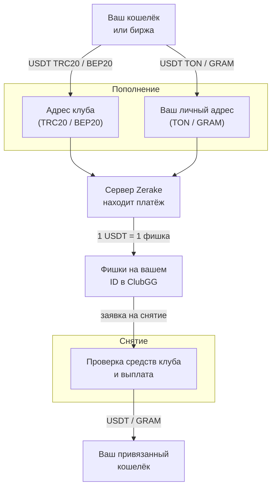

Этот раздел описывает **весь путь денег**: от вашего кошелька до фишек на ID в ClubGG и обратно. Каждый шаг расписан отдельно, у каждого процесса своя схема (нажмите на схему, чтобы открыть её на весь экран).

## Карта

## Главное в десяти пунктах

1. **1 фишка = 1 USDT.** GRAM пересчитывается по курсу.
2. Пополнять можно в **четырёх вариантах**: USDT в сетях TRC20, BEP20 и TON, монета GRAM.
3. В **TRC20 и BEP20** пополнение идёт по **заявке**: точная сумма и адрес, 30 минут. [Подробнее](/money/deposit-request/)
4. В **TON и GRAM** у вас **личный адрес**: любая сумма, без срока и комментария. [Подробнее](/money/deposit-personal/)
5. Пополнять можно **с любого кошелька**, в том числе с биржи.
6. Сервер проверяет все адреса **раз в минуту** и сам сопоставляет платёж с вами. [Подробнее](/money/detection/)
7. Снятие уходит **только на привязанный кошелёк** этой сети.
8. Перед снятием сервер **проверяет, хватает ли у клуба денег** в этой сети. [Подробнее](/money/withdrawal/)
9. Выплата идёт **напрямую с адресов, куда пришли пополнения**, без промежуточных кошельков. [Подробнее](/money/payout-sources/)
10. Комиссию при снятии берём **только в TRC20** (3 USDT + 1%). [Подробнее](/money/fees/)

## Сети одной таблицей

| | TRC20 | BEP20 | TON (USDT) | GRAM |
|---|---|---|---|---|
| Блокчейн | Tron | BNB Chain | TON | TON |
| Способ пополнения | заявка | заявка | личный адрес | личный адрес |
| Мин. пополнение | 10 USDT | 10 USDT | 1 USDT | $1 в GRAM |
| Мин. снятие | 10 | 10 | 10 | 5 |
| Комиссия снятия | 3 USDT + 1% | 0 | 0 | 0 |
| Когда платёж считается подтверждённым | подтверждён сетью Tron | 12 блоков | финализирован в TON | финализирован в TON |
