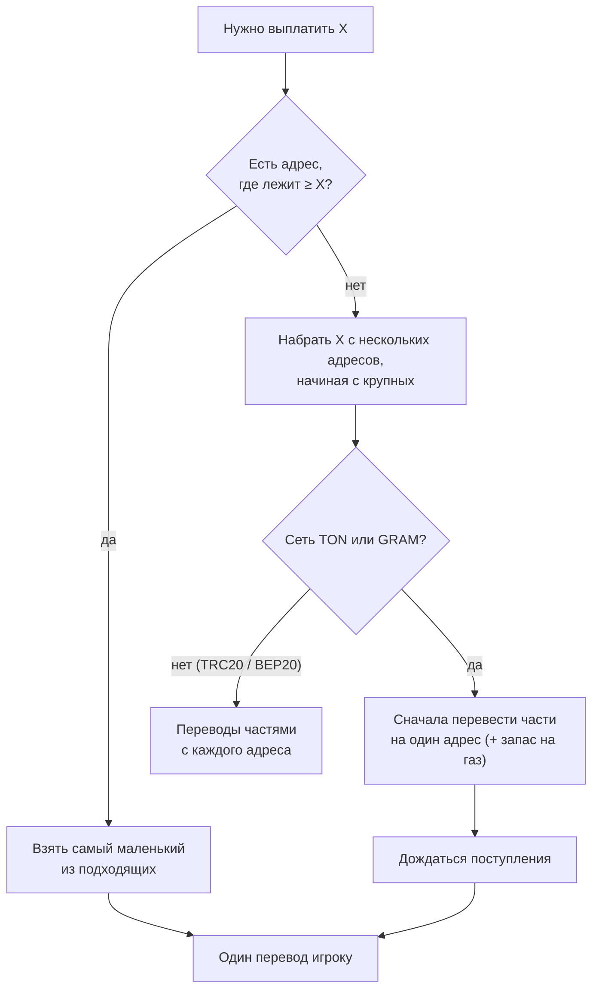

## Правило выбора

1. Сервер смотрит баланс **каждого адреса клуба** в нужной сети.
2. У каждого адреса оставляется запас на его собственную комиссию.
3. Если есть **один адрес, где хватает на всю выплату**, — платит с **самого маленького** из таких (крупные остаются для крупных выплат).
4. Если **ни на одном** не хватает — собирает сумму с нескольких адресов, **начиная с самых крупных**.

## Газ (комиссия сети) при выплате

| Сеть | Кто платит газ | Как |
|---|---|---|
| **TRC20** | игрок (в комиссии снятия) | Сервис GasFree списывает плату в USDT прямо с адреса пула — TRX не нужен |
| **BEP20** | клуб | Адрес для комиссий докидывает BNB на платящий адрес перед переводом |
| **TON (USDT)** | клуб | Кошелёк клуба докидывает ~0.07 GRAM на платящий адрес |
| **GRAM** | клуб | Газ берётся из запаса на самом адресе |

## Почему в TON и GRAM один перевод

Игроку удобнее получить **одну** транзакцию. Поэтому в TON и GRAM части сначала объединяются на одном адресе клуба, и только потом уходит один перевод вам. Каждая часть идёт **с небольшим запасом на газ** — приём перевода тоже стоит немного газа, и без запаса на адресе могло бы не хватить нескольких тысячных.

Если объединение не завершилось, **игроку ничего не отправляется** — деньги остаются у клуба, заявка возвращается команде.
