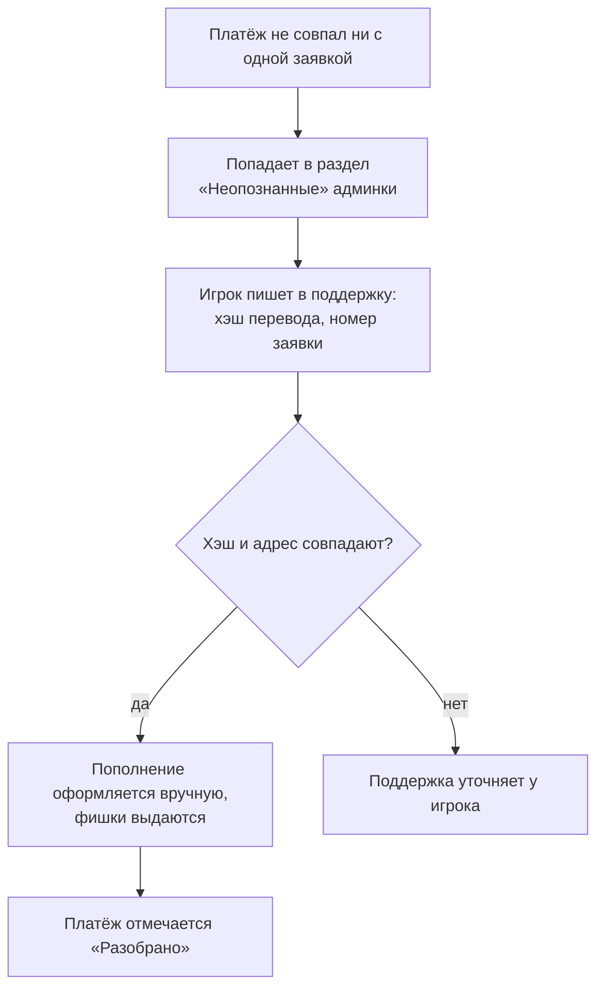

## Таблица ситуаций

| Ситуация | Что произойдёт | Что делать вам |
|---|---|---|
| Отправили **не ту сумму** по заявке (TRC20/BEP20) | Платёж станет «неопознанным» | Напишите в поддержку: хэш перевода + номер заявки |
| Оплатили **после 30 минут** | Найдётся и зачислится сам | Ничего |
| Сумма **меньше минимума** | Статус «Меньше минимума», фишки не выдаются автоматически | Напишите в поддержку с номером `DEP-…` |
| Отправили **в другой сети** (например, BEP20 на адрес TRC20) | Перевод не придёт на адрес клуба в нужной сети | Сразу в поддержку с хэшем; вернуть удаётся не всегда |
| Отправили **другую монету** на адрес TON | Не учитывается | В поддержку с хэшем |
| Неверный **ID в ClubGG** | Фишки могут уйти на чужой ID | Сразу в поддержку |
| Снятие **не принимается** в сети | У клуба сейчас не хватает средств в этой сети | Другая сеть или меньшая сумма |

## Как команда разбирает «неопознанные»

Все ручные действия команды попадают в [журнал операций](/architecture/audit-log/).
