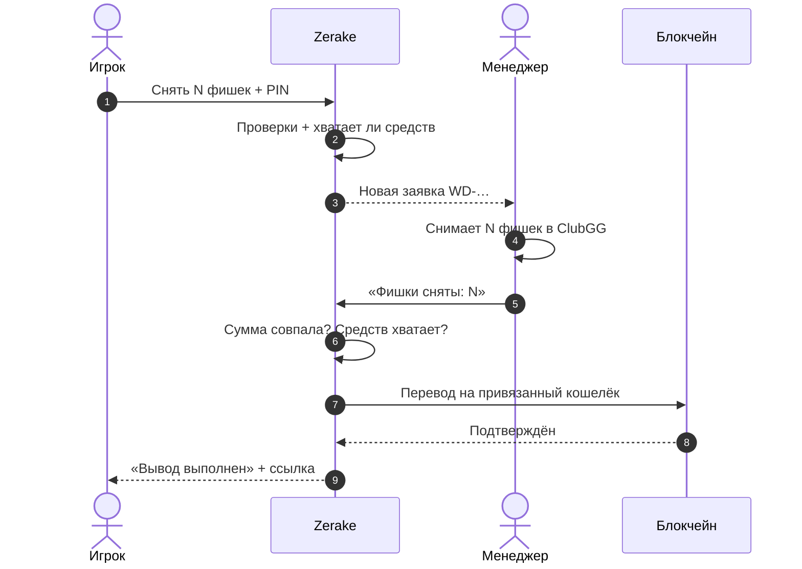
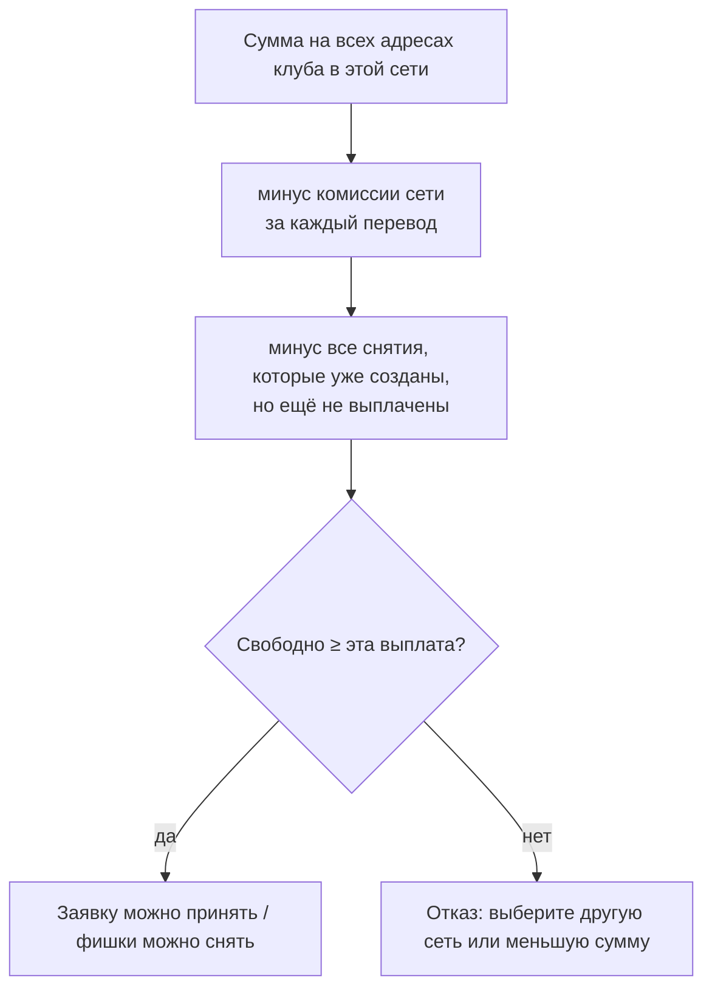

## Шаги игрока

1. Мини-приложение → **Продать** → выберите сеть.
2. Введите, сколько **фишек** снять. Сразу видно комиссию и сколько придёт.
3. Введите **PIN**.
4. Ждите уведомление «Вывод выполнен» со ссылкой на перевод.

## Проверки при создании заявки

1. **PIN** верный.
2. ID в ClubGG указан.
3. Кошелёк для выплат **привязан** в этой сети.
4. Нет **ожидающей смены кошелька** и не прошло меньше **48 часов** после восстановления аккаунта.
5. Сумма не меньше **минимума** сети.
6. Нет другой **открытой заявки** на снятие.
7. **Хватает ли у клуба денег** в этой сети — с учётом комиссий и уже созданных снятий. [Как считается](#проверка-средств-клуба)

Если всё в порядке — создаётся заявка `WD-…` «В обработке», команда получает уведомление.

## Обработка

1. Менеджер берёт заявку (**Беру**) — другие её больше не видят как свободную.
2. В ClubGG снимает с вашего ID **ровно сумму заявки** («Прилавок → Вернуть»).
3. Нажимает **«Фишки сняты»** и вводит снятую сумму — она должна **совпасть до цента**.
4. Сервер **ещё раз проверяет средства клуба**. Если не хватает — менеджер видит «Не снимайте фишки».
5. Заявка становится «Фишки сняты» и **блокируется** на выплату: второй раз она выплачена быть не может.
6. Сервер выбирает, **с каких адресов платить** ([подробно](/money/payout-sources/)), и отправляет перевод **на ваш привязанный кошелёк**.
7. Дожидается подтверждения в сети → «Выплачено», ссылка на перевод.

## Проверка средств клуба

Проверка выполняется **дважды**: при создании заявки и перед снятием фишек. Поэтому не бывает, что фишки сняли, а выплатить нечем.

## Если выплата не прошла

| Что случилось | Что будет |
|---|---|
| Ничего не отправилось (сеть перегружена, мало газа) | Заявка возвращается команде с причиной, выплату повторяют |
| Перевод отправлен, но подтверждение не пришло | Заявка остаётся на ручной проверке, **повторно автоматом не платится** |
| Сумма выше лимита автовыплаты | Выплачивает менеджер вручную |
