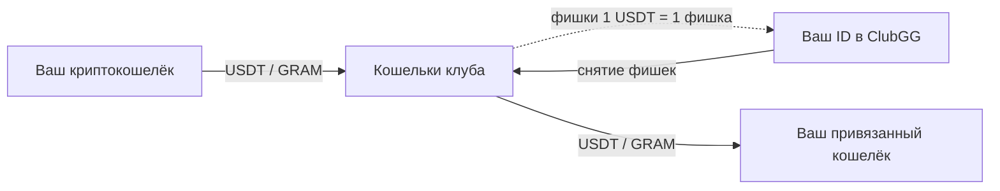

**Zerake** — клуб в приложении **ClubGG** (ID клуба `976434`), где клуб **не берёт рейк**: весь банк раздачи достаётся игрокам.

Деньги в клуб попадают и выходят через **Telegram**: бот [@zerakebot](https://t.me/zerakebot) открывает мини-приложение Zerake, где вы пополняете фишки, снимаете их и смотрите историю.

## Из чего состоит клуб

| Часть | Что это | Где |
|---|---|---|
| Столы | Игра, фишки на вашем ID | приложение ClubGG |
| Мини-приложение | Пополнение, снятие, история, настройки | [@zerakebot](https://t.me/zerakebot) → «Открыть» |
| Сайт | Информация о клубе | [zerake.com](https://zerake.com) |
| Поддержка | Вопросы людям из команды | бот поддержки, кнопка «Поддержка» в @zerakebot |
| Документация | Эти страницы | docs.zerake.com |

## Как движутся деньги и фишки

- **1 фишка = 1 USDT.** Для монеты GRAM фишки считаются по курсу в момент поступления.
- Фишки живут на вашем **ID в ClubGG**. Пополнение — это перевод криптовалюты клубу и выдача фишек на ваш ID. Снятие — наоборот.
- Выплата уходит **только на ваш привязанный кошелёк** — подробнее в разделе [Кошелёк для выплат](/account/payout-wallet/).

## Сети

Пополнять и снимать можно в четырёх вариантах: **USDT TRC20** (Tron), **USDT BEP20** (BNB Chain), **USDT в сети TON** и монета **GRAM** (сеть TON). Подробности — в [справочнике сетей](/reference/networks/).
