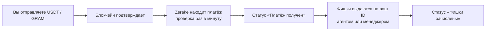

Пополнение фишек — это перевод криптовалюты на кошелёк клуба, после которого фишки приходят на ваш ID в ClubGG.

## Два способа в зависимости от сети

| | TRC20, BEP20 | TON, GRAM |
|---|---|---|
| Как | [Заявка](/top-up/request/): точная сумма и адрес | [Личный адрес](/top-up/personal-address/): любая сумма |
| Срок | 30 минут на оплату | Без срока |
| Сумма | Ровно та, что в заявке | Любая от минимума |
| Комментарий/мемо | Не нужен | Не нужен |

## Что видно в приложении

Приложение само следит за платежом — перезапускать ничего не нужно:

- **«Платёж получен… Фишки в пути»** — деньги дошли, фишки выдаются;
- **«Фишки зачислены»** — фишки на вашем ID в ClubGG;
- красное **«меньше минимума»** — сумма ниже минимальной, напишите в поддержку.

Плюс сообщение от бота в Telegram.

## Сколько ждать

| Этап | Обычно |
|---|---|
| Подтверждение в блокчейне | TRC20 ~1 мин, BEP20 ~10–20 с, TON ~5–10 с |
| Zerake находит платёж | до 1 минуты |
| Выдача фишек | от нескольких секунд (агент) до нескольких минут (менеджер) |

Минимумы и максимумы — в [справочнике](/reference/networks/).
