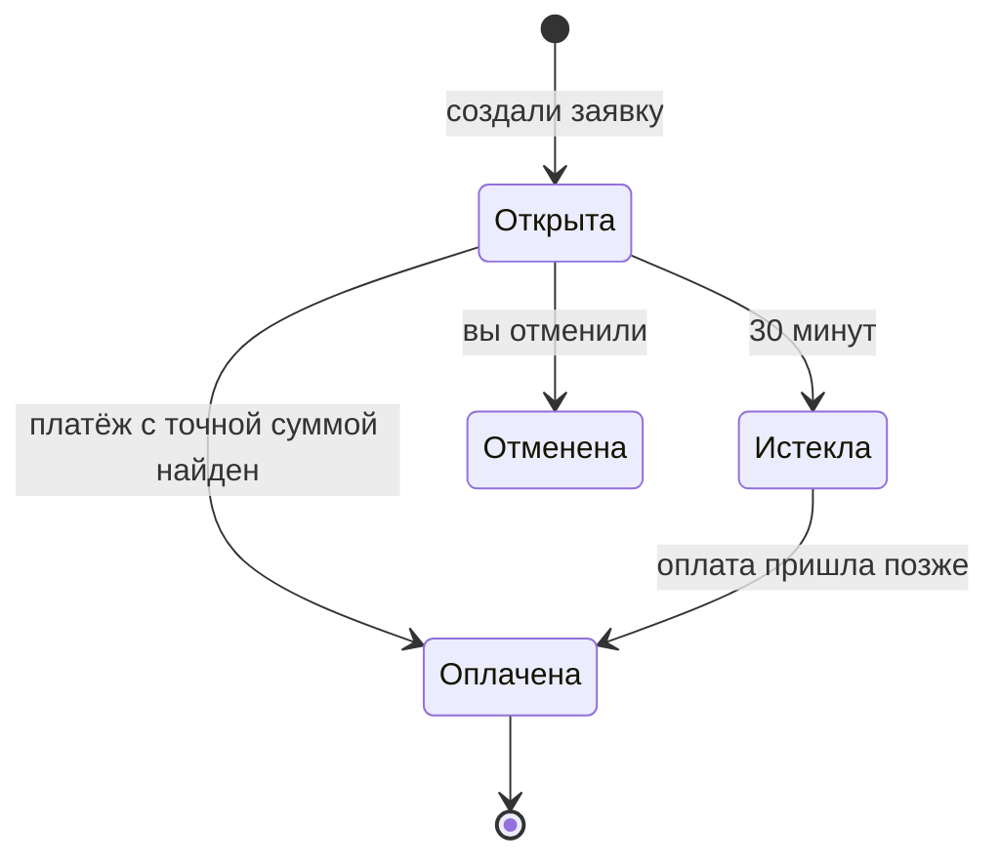

В сетях **TRC20** и **BEP20** пополнение идёт по **заявке**.

## Шаги

1. Вкладка **Купить** → сеть **TRC20** или **BEP20**.
2. Введите, на сколько фишек пополнить (например, `50`) → **Создать заявку**.
3. Приложение покажет:
   - **точную сумму**, например `50.37 USDT`;
   - **адрес** клуба и QR-код;
   - таймер **30 минут**.
4. Отправьте **ровно эту сумму** на этот адрес в выбранной сети.

## Почему сумма «с хвостом»

Копейки в конце (`.37`) — это метка вашей заявки. По ней Zerake понимает, что платёж ваш. Фишек вы получаете столько, сколько заказали (`50`), а «хвост» не теряется — он учитывается.

:::caution[Не округляйте]
Отправите `50` вместо `50.37` — платёж может не сопоставиться с заявкой. Его найдут вручную, но это дольше.
:::

## Комиссия сети

Комиссию сети платит **отправитель** — то есть ваш кошелёк или биржа:
- **TRC20** — с биржи обычно несколько долларов;
- **BEP20** — несколько центов.

Сумма, которую вы отправляете, должна дойти **целиком**: если биржа вычитает комиссию из суммы перевода, увеличьте сумму на размер комиссии.

## Если 30 минут прошли

Ничего страшного: если вы уже заплатили, платёж всё равно найдётся и зачислится. Если не платили — создайте новую заявку. Пока заявка открыта, её можно отменить.

